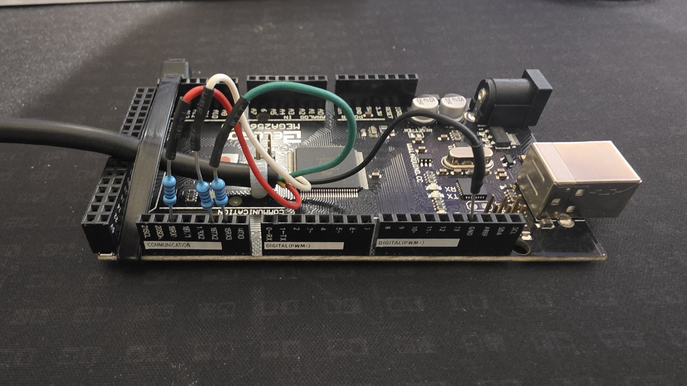

# Jura Service Reader

[](https://github.com/AssasinOrange/jura-service-reader/actions/workflows/test.yml)

A tested, read-only Arduino interface for the TTL service port on a Jura
GIGA X8c Professional. It identifies the controller, reads the verified
settings block, decodes Jura's four-carrier transport and displays the stored
four-digit PINs on a small OLED.



## What has been verified

The complete path below worked on one machine:

| Item | Verified result |
| --- | --- |
| Machine | Jura GIGA X8c Professional |
| Controller response | `EF658M V15.26` |
| Electrical interface | 5 V TTL UART, 9600 baud, 8 data bits, no parity, 1 stop bit |
| Model query | `TY:\r\n` |
| Settings read | `RT:01E0\r\n` |
| RT reply | 32 data bytes represented by 64 hexadecimal characters |
| Address unit | 16-bit word; `RT:0001` advances the reply by two bytes |
| Main PIN | packed BCD at RT payload bytes 8–9, relative byte offset `0x03C8`, word address `0x01E4` |
| Cleaning PIN | packed BCD at RT payload bytes 4–5, relative byte offset `0x03C4`, word address `0x01E2` |

The recovered main PIN was accepted by the machine and opened its five-page
programming menu. The public repository does not contain the owner's raw
capture or its decoded PIN values.

## Choose a workflow

### Standalone OLED reader

Use [`firmware/JuraPinReader`](firmware/JuraPinReader) with an Arduino Mega
2560, a common 128×64 SSD1306 I²C display and one momentary button. Pressing
the button:

1. sends `TY:`;
2. requires the exact verified `EF658M V15.26` profile;
3. requests only `RT:01E0`;
4. decodes and displays the two PIN fields.

Install **Adafruit GFX Library** and **Adafruit SSD1306** through Arduino
Library Manager before compiling. See the complete [build guide](docs/build.md).

### Evidence capture and analysis

[`capture/JuraFullCapture`](capture/JuraFullCapture) is the Windows/Arduino
capture rig used during the investigation. It preserves each received carrier
byte with timestamps, UART error flags, sequence numbers and CRC protection.
The supplied Python tools decode and inspect those captures.

Start with the [capture instructions](capture/JuraFullCapture/README.txt) and
[offline analysis guide](docs/analysis.md). The extractor preserves raw RT
replies and reports missing bytes and conflicts. To display PINs, it requires
an explicit verified-controller profile, complete capture integrity checks,
and both PIN fields actually present. Its generated files still contain
private settings even when PIN display is disabled; do not publish them.

## Tests and reproducible builds

From the repository root, run the standard-library Python tests:

```sh
python -m unittest discover -s tests -p 'test_*.py' -v
```

GitHub Actions runs these on Python 3.10 and 3.13, runs the C++ protocol tests
with memory/undefined-behaviour checks, and compiles both Mega sketches. See
[build.md](docs/build.md) for the pinned Arduino dependencies and compile
commands. Compilation and synthetic tests do not replace a hardware trial.

## Wiring

The machine connector looks like RS-232 but the verified interface is TTL.
Use the printed pin numbers on a breakout connector.

| Jura DE-9 | Signal | Arduino Mega | Connection |
| ---: | --- | ---: | --- |
| 1 | machine TX | 19 / RX1 | through 1 kΩ series resistor |
| 2 | signal GND | GND | direct |
| 3 | machine RX | 16 / TX2 | through 1 kΩ series resistor |
| 4 | +5 V from machine | — | leave disconnected |
| 5–9 | unused on tested machine | — | leave disconnected |

Power the Mega independently over USB. Do not connect Jura pin 4 to the
Mega's 5 V rail. Do not connect a conventional ±12 V PC RS-232 interface.
See [the illustrated wiring guide](docs/wiring.md) before connecting anything.

## Why four UART bytes carry one character

For each ordinary byte, the protocol sends four carrier bytes. Bits 2 and 5
of carrier `i` hold payload bits `2i` and `2i+1`. The implementation used here
is:

```text
carrier[i] = 0xDB
           | (((value >> (2*i))   & 1) << 2)
           | (((value >> (2*i+1)) & 1) << 5)
```

The machine accepted the high-bit-set carrier family `DB/DF/FB/FF`. The
decoder accepts the equivalent fixed-bit mask used by earlier implementations.
See [protocol.md](docs/protocol.md) for the full exchange.

## Model support

Only `EF658M V15.26` has a verified PIN profile. Other machines may speak the
same transport while keeping settings at different addresses. The standalone
reader displays **UNVERIFIED PROFILE** instead of interpreting unknown memory
as credentials.

Model reports and sanitised protocol observations are welcome as issues or
pull requests. Keep raw dumps, RT reply hex, reconstructed maps and recovered
credentials private. See [CONTRIBUTING.md](CONTRIBUTING.md) before sharing data.

## Repository contents

| Path | Purpose |
| --- | --- |
| `firmware/JuraPinReader/` | one-button OLED reader |
| `capture/JuraFullCapture/` | loss-aware Mega firmware and Windows recorder |
| `tools/jura_codec.py` | reusable four-carrier codec and RT parser |
| `tools/decode_capture.py` | binary capture-to-CSV decoder |
| `tools/extract_rt.py` | extracts addressed RT replies from a capture |
| `docs/` | wiring, protocol and verified memory map |
| `tests/` | protocol and parser tests |

## Credits

The transport and EEPROM commands build on earlier public work by
[Q42 coffeehack](https://github.com/Q42/coffeehack),
[Jutta-Proto/protocol-cpp](https://github.com/Jutta-Proto/protocol-cpp), and
[oliverk71/Coffeemaker-Payment-System](https://github.com/oliverk71/Coffeemaker-Payment-System).
The pinout, response shape, address behaviour and profile offsets documented
here were measured on the machine shown in this repository.

This project is independent and is not affiliated with or endorsed by JURA.
JURA is a trademark of its respective owner.

Code is available under the [MIT License](LICENSE). Photographs remain
copyright © 2026 Mark; see [`docs/images/README.md`](docs/images/README.md).
