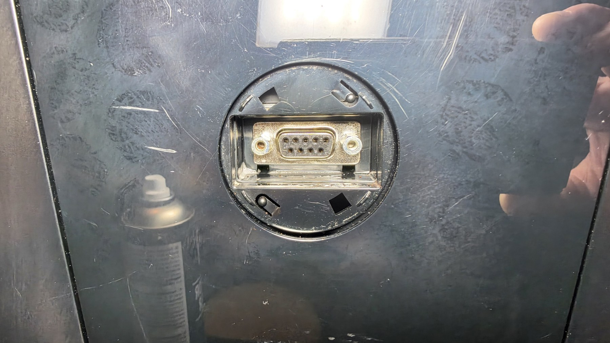
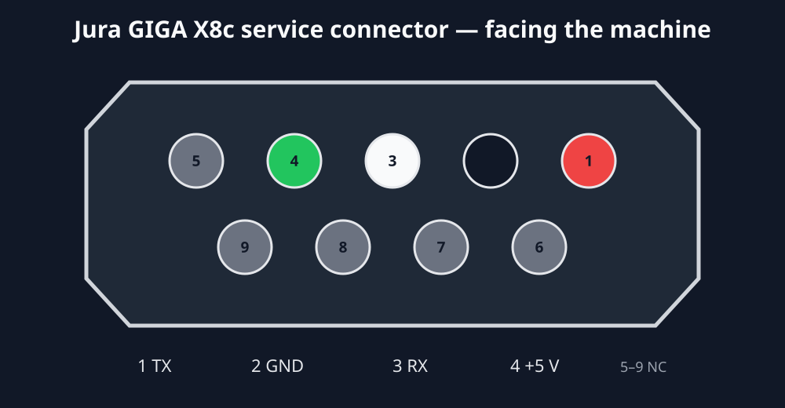
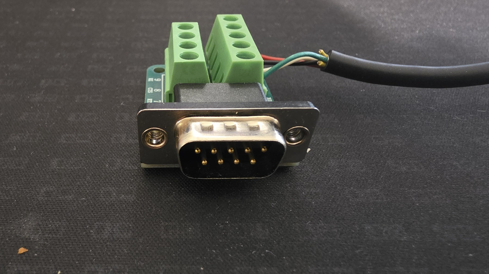
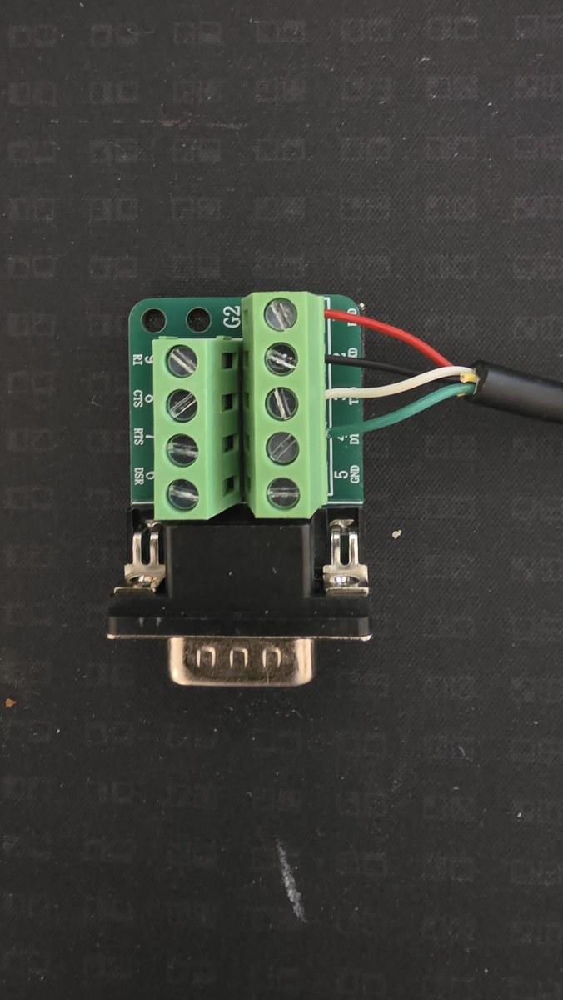
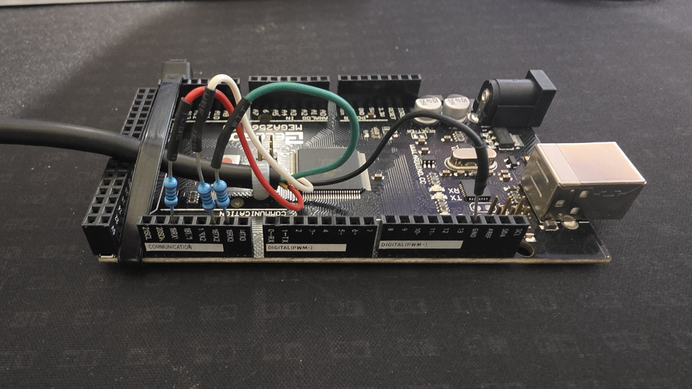

# Wiring the tested GIGA X8c Professional

The photographs below show the exact rig used to obtain valid `TY:` and `RT:`
replies. Connector drawings are shown from their mating faces; front views of
male and female connectors are mirror images.

## Machine socket

Facing the female socket on the machine, the top row reads `5 4 3 2 1` from
left to right. The tested contacts are therefore the four rightmost contacts
on that row. The shell was not used as signal ground.

## Mating plug

The breakout board exposes numbered screw terminals. Those printed numbers
remove the usual front/back mirroring ambiguity.

| Wire in photographed rig | Jura pin | Role | Mega connection |
| --- | ---: | --- | --- |
| red | 1 | Jura TX | 1 kΩ → 19 / RX1 |
| black | 2 | signal ground | GND |
| white | 3 | Jura RX | 1 kΩ → 16 / TX2 |
| green | 4 | machine +5 V | 1 kΩ → 15 / RX3 in the capture rig only |

The standalone reader does not need the green pin-4 monitor wire; leave pin 4
disconnected. The capture rig monitored it to establish that it remained an
idle supply rather than a data channel.

## Mega end

The 1 kΩ parts are series resistors. With a high-impedance UART input they do
not intentionally divide a valid 5 V logic level. They limit fault current
during development and provide some isolation when two outputs are
accidentally connected.

## Electrical facts established on this machine

- Logic idle measured approximately +5 V relative to Jura pin 2.
- Valid traffic decoded at 9600 8N1.
- Pin 1 carried the machine's replies.
- Pin 3 accepted requests transmitted by the Mega.
- Pin 4 was not required for communication.
- The metal connector shell was not a usable signal reference.

Do not substitute an ordinary PC serial cable or USB-to-RS232 adapter. RS-232
uses different polarity and voltage levels. A 5 V TTL UART is required.
